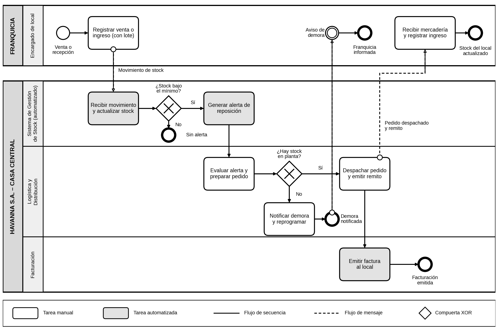

# Havanna S.A. – Módulo de Gestión de Franquicias y Trazabilidad de Stock

Documentación técnica del Trabajo Práctico Integrador y Progresivo (TPI) de **Organización Empresarial**, Tecnicatura Universitaria en Programación a Distancia (TUP AD), Universidad Tecnológica Nacional (UTN).

## Descripción del sistema

Havanna S.A. opera una red de locales propios y franquiciados en distintos países, lo que dificulta tener visibilidad centralizada y en tiempo real del stock de cada punto de venta. El sistema propuesto centraliza el inventario de los locales, registra cada movimiento con su lote y alerta cuando un producto baja del stock mínimo, para que Producción, Logística, Facturación y la Dirección General trabajen con información actualizada.

**Objetivo general:** centralizar en tiempo real la información de inventario de los locales propios y franquiciados, para optimizar la toma de decisiones en producción, distribución y facturación.

## Integrante

| Nombre | Comisión |
|---|---|
| Rodríguez, Ciro | N.° 5 |

## Estructura del repositorio

```
havanna-gestion-franquicias/
├── README.md
└── docs/
    ├── 01_diccionario_de_datos.md
    ├── 02_proceso_bpmn.md
    ├── 03_historias_de_usuario.md
    ├── 04_indicadores_de_control.md
    ├── organigrama_area_sistemas.png
    └── bpmn_reposicion_de_stock.png
```

## Documentación

- [Diccionario de datos](docs/01_diccionario_de_datos.md)
- [Proceso de negocio en BPMN](docs/02_proceso_bpmn.md)
- [Historias de usuario](docs/03_historias_de_usuario.md)
- [Indicadores de control](docs/04_indicadores_de_control.md)
- Organigrama del área de Sistemas: [imagen](docs/organigrama_area_sistemas.png)

## Proceso de negocio (BPMN)



## Backlog ágil

Tablero en GitHub Projects: https://github.com/users/ciro-rdz/projects/1

| ID | Historia de usuario | Prioridad | Estado |
|---|---|---|---|
| HU-01 | Como encargado de un local franquiciado, quiero registrar las ventas y los ingresos de mercadería indicando su lote, para que el stock de mi local se actualice en tiempo real. | Alta | Listo |
| HU-02 | Como analista de Logística y Distribución de la casa central, quiero recibir una alerta cuando el stock de un producto en un local baje del mínimo, para planificar la reposición antes de que se produzca un quiebre de stock. | Alta | En Progreso |
| HU-03 | Como miembro de la Dirección General, quiero ver un reporte consolidado del stock por local, ciudad y país, para decidir la producción y la distribución con datos actualizados. | Media | Por Hacer |

El detalle y los criterios de aceptación están en [docs/03_historias_de_usuario.md](docs/03_historias_de_usuario.md).

## Flujo de trabajo con Git

- **Ramas:** `main` contiene la versión revisada. Cada cambio se desarrolla en una rama secundaria (`docs/<tema>`) y se integra mediante Pull Request.
- **Commits:** mensajes descriptivos con el formato `tipo: descripción en infinitivo`, por ejemplo `docs: agregar diccionario de datos con cuatro entidades`.
- **Pull Requests:** todo cambio hacia `main` requiere la revisión de otra persona antes de fusionarse. El Pull Request de referencia es https://github.com/ciro-rdz/havanna-gestion-franquicias/pull/1.

## Indicadores de control

| ID | Indicador | Estándar | Responsable |
|---|---|---|---|
| K1 | Tiempo de respuesta de consultas de stock | ≤ 2 s (Meta 1) | Jefatura de Calidad (QA) |
| K2 | Capacidad de la plataforma | ≥ 500 locales y 10.000 SKU (Meta 2) | Jefatura de Infraestructura y Soporte |
| K3 | Reducción del tiempo de conciliación | ≥ 30 % a los 6 meses (Meta 3) | Gerencia de Sistemas |
| K4 | Cumplimiento del cronograma | Desvío ≤ 10 % (Meta 4) | Oficina de Proyectos (PMO) |
| K5 | Exactitud de inventario | ≥ 98 % (propuesto) | Jefatura de Calidad (QA) |
| K6 | Disponibilidad del sistema | ≥ 99,5 % (propuesto) | Jefatura de Infraestructura y Soporte |
| K7 | Trazabilidad por lote | 100 % | Jefatura de Calidad (QA) |
| K8 | Historias de usuario controladas | 100 % | Oficina de Proyectos (PMO) |
| K9 | Cambios integrados con revisión | 100 % | Jefatura de Desarrollo |

La fórmula, la fuente y la frecuencia de cada indicador están en [docs/04_indicadores_de_control.md](docs/04_indicadores_de_control.md).

## Declaración de Uso de IA

Se utilizó el asistente de IA generativa **Claude (Anthropic)** para estructurar el trabajo, proponer diseños y corregir el estilo. Se detallan los prompts, su justificación y las correcciones humanas realizadas.

| Prompt (resumen) | Por qué lo utilicé | Resultado | Corrección humana |
|---|---|---|---|
| Cargué la consigna de la Entrega 3 y mis Entregas 1 y 2, y pedí armar la entrega. | Dar contexto del mismo caso (Havanna S.A.) para mantener coherencia entre entregas y ahorrar tiempo de maquetación. | Borrador del organigrama del área de Sistemas, del diccionario de datos (4 entidades) y del documento en PDF. | [COMPLETAR: qué revisaste o cambiaste, por ejemplo entidades, campos, tipos de dato o redacción.] |
| Pegué la lista de verificación de la cátedra y pregunté si la entrega cumplía. | Contrastar lo producido con los requisitos oficiales y no depender solo de mi lectura. | Señaló que el organigrama modelaba el área de Sistemas y no toda la empresa, y que faltaba la plantilla de la cátedra. | [COMPLETAR: qué decidiste sobre el alcance del organigrama y la plantilla.] |
| Cargué la consigna de la Entrega 4 y pedí armarla, indicando que trabajo solo y que uso GitHub y GitHub Desktop. | Obtener una propuesta de BPMN, historias de usuario, indicadores y archivos del repositorio, coherente con las Entregas 1 a 3. | Propuesta de proceso BPMN, tres historias de usuario, nueve indicadores, README y guía de trabajo con Git. | [COMPLETAR: qué historias, indicadores y valores aceptaste, modificaste o descartaste, y por qué.] |

**Limitaciones identificadas y controles aplicados:**

- Los asistentes de IA tienden a proponer estructuras y redacciones genéricas, por lo que cada decisión se contrastó con el caso de Havanna S.A. y con las entregas previas.
- Los estándares de los indicadores K5 y K6 (98 % y 99,5 %) son valores propuestos sin base empírica de la organización y deben validarse con ella.
- Los tipos de dato del diccionario son genéricos y deben ajustarse al motor de base de datos que se elija.
- La IA no puede comprobar qué historial de commits, revisiones o estados del tablero existen realmente en GitHub, por lo que esa evidencia fue generada y verificada por el autor.

El autor asume la responsabilidad intelectual sobre la veracidad y coherencia de lo presentado.

## Estado del proyecto

Etapa de análisis y diseño (documentación). La codificación del sistema queda planificada según el cronograma de 12 semanas definido en la Entrega N.° 2.
